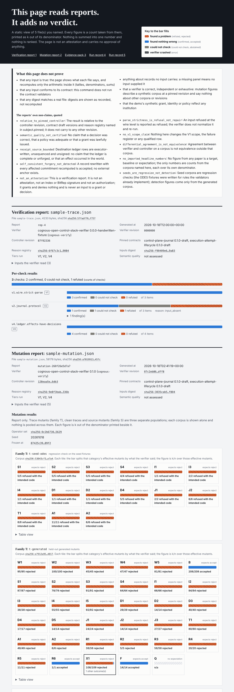
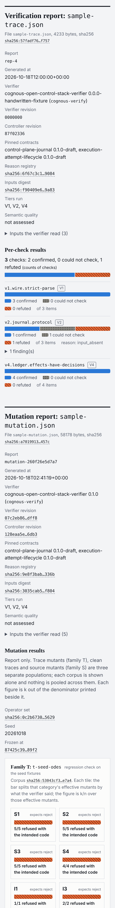

# Dashboard: what it shows and what it does not prove

```
cognous-ocs dashboard --out FILE INPUT [INPUT ...]
```

Reads any mix of the inputs below and writes one self-contained HTML file. It is read-only: it runs no component, validates nothing against a contract and adds no verdict of its own. It needs at least one input.





The pictures come from the files in [`dashboard-sample/`](dashboard-sample): `sample-trace.json` (a hand-written synthetic verification report from the ODES contract fixtures), `sample-mutation.json` (the real mutation report of the verifier harness at frozen revision `87425c39`, with the per-scenario tables dropped to keep the file small and one local path in an extension shortened to `cognous-verify`), `sample-pack.json` (the bundled synthetic evidence pack) and two real `bounded-run-record.json` files from an `acp run` demo. Reproduce with `cognous-ocs dashboard --out view.html docs/dashboard-sample/sample-*.json`.

## Inputs

A file is recognised by what it contains, not by its name. A directory is read as demo output.

| Input | Shown as |
|---|---|
| Verification report (`cognous-verify`, `verification-report/0.1`, `0.1.0-draft`) | run identity; one segmented bar per check (confirmed, could not check, refuted) with the item counts; findings |
| The same report with a `mutation_report` | one tile grid per family T corpus; a separate panel for clean false rejection; family S as a separate context-only panel |
| Evidence pack (`pack_version` 0.1) | counts of what the pack lists and the blocked actions with their reasons |
| Bounded run record (`acp run`, `bounded-run-record.json`) | a strip of its decisions, attempts and observations in order |
| Demo result (`demo-result.json`) | the demo's own outcome as recorded, facts held and steps as expected as k/n |
| Demo output directory | `demo-result.json`, `control/*/out/bounded-run-record.json` and `outputs/evidence-pack.json`, whichever exist |

Inputs render in the order given. Per-scenario mutation tables and the `metric_impact` figures are not rendered; the report keeps them.

## How to read it

- One key for every bar: orange with diagonal hatching is "found a problem" (refuted or rejected), solid blue is "found nothing wrong" (confirmed or accepted), grey with dots is "could not check" (or abstained), a crossed fill is "verifier crashed". Each state also has a word beside it; colour is never the only carrier. The palette is the validated blue and orange of the data-viz default, with grey for the neutral state.
- Every figure is a count, or k out of the denominator printed next to it. A zero denominator prints `n/a`. There is no percentage anywhere, no composite score, no grade, no ranking, no gauge, and no safe/unsafe colouring.
- A mutation tile's bar splits that category's effective mutants by what the verifier said. Its figure is the one that category is about: rejected for categories that should be rejected, accepted for those that should be accepted (benign, forgery bound), refused with the intended code for seed regression rows. A tile with any other outcome gets a heavier border and a line saying how many.
- Family T corpora, clean corpora and family S are never pooled: each has its own panel and its own denominators. A clean tile's filled part is traces the verifier rejected; the report does not say whether the rest were accepted or abstained, and the page does not guess.
- Digests are shortened (`sha256:3d51cd8e…ae3c`). With scripts on, clicking one copies the full value; without scripts, or when printing, the full value is shown. The one inline script is pinned by a hash in the page's content security policy.
- Every chart has a table view. The page works in light and dark, at phone width, in print, and with the keyboard.
- Event strips are spaced by order, not to a time scale. Events are ordered by recorded time, then decision, attempt, observation, then record order.

## Refusals

A malformed input is refused with exit 2 and nothing is written. That includes: not strict JSON (duplicate members, NaN, non-UTF-8), an undeclared member in a report (so a `score` member is refused, as the contract requires), a digest that is not `sha256:` plus 64 hex characters, a tally that does not sum, a verdict its tally does not derive, a summary that does not match the checks, `k` above `n`, verdict counts that do not sum to the effective count, a seed corpus with a detection figure, a family S row that does not sum, a repeated corpus or category, a contract version other than `0.1.0-draft` (`OCS_KIND_UNREGISTERED`), a symlinked demo file, and an event time that is not ISO-8601. These are arithmetic and shape checks on what the page reads. They are not the contract validators. Output paths follow the CLI contract: inside the workspace or temp directory, no symlink or hard link, no input aliasing the output (`OCS_PATHS`). Like `evidence render`, a nonzero exit writes `ci-diagnostics.json` next to the output file.

Limits: 40 MB per file, 50 inputs, 400 events per run record, 5000 rows per list, 4000 characters per string.

## What it does not prove

The page repeats this list.

- That any input is true. It shows what each file says and recomputes only the arithmetic inside it.
- That any input conforms to its contract. Run `cognous-ocs validate` or the contract validator for that.
- That any digest matches a real file. Digests are shown as recorded, not recomputed.
- Anything about records no input carries. A missing panel means no input supplied it.
- That a verifier is correct, independent or exhaustive. Mutation figures describe a synthetic corpus at a pinned revision and say nothing about other corpora or revisions.
- That the demo's synthetic grant, identity or policy reflect any institution.

The page is not an attestation and carries no approval of anything. The JSON result carries no `verdict_source`, and its `does_not_prove` repeats the list above.

## Design notes

Stdlib only, like `evidence render`: inline CSS, inline SVG for the event strip, no fonts, images or requests, and a content security policy that allows nothing but inline styles and the one hashed script. Rendering is deterministic: no render time is embedded, so the same files give the same bytes. Every string from an input has control characters stripped and is HTML-escaped; the script reads attributes and writes `textContent` only.
